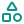
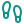
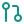

<!-- readme-standard: 2026-11-02 -->

# Psanctuary: .github

*The organisation's profile, its welcome deck, and the defaults every repository here shares.*

 **You are here:** Psanctuary › `.github` · public · `main` is the working branch

##  TL;DR

1.  **What this is.** The repository behind [the organisation page](https://github.com/psanctuary): GitHub shows [`profile/README.md`](profile/README.md) there.
2.  **Who it is for.** Anyone who arrives at Psanctuary on GitHub, and anyone changing the pages every repository here shares.
3.  **Do this first.** Joined? [`ONBOARDING.md`](ONBOARDING.md). Visiting? [The organisation page](https://github.com/psanctuary).

##  What is inside

| | Where | What it holds |
|---|---|---|
|  | [`profile/`](profile/) | the organisation page GitHub shows, with its banners and icons; [`psanctuary.github.io`](https://github.com/psanctuary/psanctuary.github.io) copies its README from here every hour |
|  | [`decks/`](decks/) | the welcome deck, as markdown, HTML and PDF |
|  | [`ONBOARDING.md`](ONBOARDING.md) | for anyone who has joined: two-factor sign-in, connecting a helper, how the work is done |
|  | [`CONTRIBUTING.md`](CONTRIBUTING.md) | the default contributing guide for repositories here that have none of their own |
|  | [`SECURITY.md`](SECURITY.md) | how to report a security problem |
|  | [`CONTACTS.md`](CONTACTS.md) | the addresses and channels the church publishes |
|  | [`SOCIAL-PREVIEWS.md`](SOCIAL-PREVIEWS.md) | how to refresh link previews in chat apps, and the share-image ledger |
|  | [`TRADEMARKS.md`](TRADEMARKS.md), [`LICENSE`](LICENSE), [`LICENSE-CONTENT`](LICENSE-CONTENT) | code is MIT; written content is CC BY-SA 4.0; names, logos and marks are covered by neither |

##  Suggest a change

Noticed something? Open an [issue](../../issues), or for a small fix a pull request against `main`; [`CONTRIBUTING.md`](CONTRIBUTING.md) says how. Christopher W ([@drasticstatic](https://github.com/drasticstatic)) looks after this repository, and a person with the role merges with a merge commit. Not on GitHub? Write to [info@psanctuary.org](mailto:info@psanctuary.org).

This front door follows the living [README standard](https://github.com/drasticstatic/my-template/blob/main/README-STANDARD.md). Copy it, improve it. Icons: Lucide (ISC), see <code>assets/icons/LICENSE</code>.
